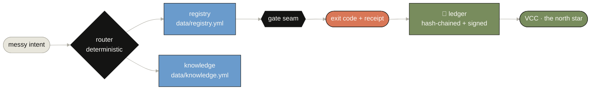

<div align="center">

# 🛡️ secure-anything

### The composition layer for agent security — **lean core, rich ecosystem.**

**Every consequential action an AI agent takes should pass a gate a machine can re-run and an auditor can re-verify years later. Security for agents stops being a vendor's claim and becomes an exit code plus a signed receipt.**

[](https://github.com/wjlgatech/secure-anything/actions/workflows/ci.yml)
[](pyproject.toml)
[-d97757)](tests/test_core_invariants.py)
[](LICENSE)

[Charter](docs/VISION.md) · [Contract](GOAL.md) · [Roadmap](ROADMAP.md) · [The super-tool](skills/secure-anything/SKILL.md) · [AgentGate organ](docs/organs/agentgate/README.md)

</div>

---

## Where we stand

<!-- BEGIN GENERATED: northstar -->
**Verified Control Coverage (VCC): 0/20 = 0.0%**  ← the north star

- Capabilities: 0 🟢 integrated · 2 🟡 digested · 30 ⚪ candidate
- Knowledge cards: 3 claimed · 19 corroborated · 1 disputed · 12 verified
- 17 control(s) are **mapped** to a capability but have no run receipt. Mapped is not measured — they count as zero.
<!-- END GENERATED: northstar -->

> **Zero VCC is the honest answer at M0.** The north star only counts a capability whose gate has
> actually run *here* and left a receipt. Naming a tool moves it by nothing — which is the point.
> The number is the work queue, not the scoreboard.

---

## The one idea

A meta-repo **owns no domain logic**. Its product is a *verified composition*:

| | |
|---|---|
| 🧠 **Lean core** (`src/secure_anything/`, ≤600 LOC, CI-gated) | a **registry** of capabilities · a deterministic **router** · a uniform **gate seam** · a hash-chained, Ed25519-signed **ledger** · the **north-star** metric |
| 🌍 **Rich ecosystem** (`data/*.yml`) | **capabilities** (scanners, guardrails, red-team, benchmarks, policy, provenance) + **knowledge cards** (papers, books, blogs, people, labs, standards) + **organs** that do the domain work — counts are generated above, never typed by hand |

The core is small on purpose and the test suite enforces it: `test_core_is_lean` fails the build if
the composition layer grows past its budget, and `test_core_names_no_vendor_or_protocol` fails if the
core ever learns what a GitHub is. Domain knowledge lives in an **organ** (ours) or a **satellite**
(theirs) — never in the middle.



## The status ladder *is* the product

| mark | means | moves the north star? |
|---|---|---|
| ⚪ **candidate** | named, role assigned, metadata API-verified | **no** |
| 🟡 **digested** | `docs/satellites/<id>.md` + pinned SHA + confirmed licence | **no** |
| 🟢 **integrated** | its gate **ran here**, exit code recorded in `runs/<id>/` | **yes** |

`scripts/verify_registry.py` **refuses** a promotion whose on-disk evidence is missing. An
awesome-list can claim 200 tools; this repo can only claim what left a receipt.

---

## Capabilities

<!-- BEGIN GENERATED: capabilities -->

**Gate (ours)**

| | id | what it does | license | covers |
|---|---|---|---|---|
| 🟡 | [`agentgate`](src/secure_anything/organs/agentgate) | PR firewall for human + AI-agent code changes: verify → classify actor → deterministic checks → optional LLM review → actor-aware decision → hash-chained, Ed25519-signed audit | Proprietary — All Rights Reserved | LLM01, LLM02, LLM03, LLM06, ASI02, ASI03, ASI04, ASI09 |

**Scanners**

| | id | what it does | license | covers |
|---|---|---|---|---|
| 🟡 | [`codex-security`](https://github.com/openai/codex-security) | CLI + TypeScript SDK that finds, validates (sandbox-executes to kill false positives), and fixes security vulnerabilities in a repo | Apache-2.0 | LLM02, LLM03, LLM05, ASI05 |
| ⚪ | [`claude-code-security-review`](https://github.com/anthropics/claude-code-security-review) | GitHub Action that uses Claude to security-review a diff — the AI-reviewer counterpart to AgentGate's deterministic checks | MIT | LLM02, LLM05 |
| ⚪ | [`codeql`](https://github.com/github/codeql) | Dataflow/taint analysis as queries over a code database; the queries powering GitHub code scanning | MIT | LLM05, ASI05 |
| ⚪ | [`semgrep`](https://github.com/semgrep/semgrep) | Lightweight, offline, pattern-based static analysis across many languages — the deterministic scanner that CAN run inside an offline gate | LGPL-2.1 | LLM02, LLM05, ASI05 |

**Guardrails (runtime)**

| | id | what it does | license | covers |
|---|---|---|---|---|
| ⚪ | [`guardrails-ai`](https://github.com/guardrails-ai/guardrails) | Structural, type and quality guarantees on LLM output via composable validators | Apache-2.0 | LLM05, LLM09 |
| ⚪ | [`invariant`](https://github.com/invariantlabs-ai/invariant) | Guardrails for agent development — trace-level policies over tool calls and agent behaviour | Apache-2.0 | ASI02, ASI03, ASI07 |
| ⚪ | [`llm-guard`](https://github.com/protectai/llm-guard) | Input/output scanning toolkit for LLM interactions — prompt-injection, PII, toxicity, secrets leakage | MIT | LLM01, LLM02, LLM07 |
| ⚪ | [`nemo-guardrails`](https://github.com/NVIDIA-NeMo/Guardrails) | Programmable rails (Colang) constraining what an LLM app may say and do — policy as executable dialogue flow | NOASSERTION ⚠️ pointer-only | LLM01, LLM06, ASI01 |
| ⚪ | [`purplellama`](https://github.com/meta-llama/PurpleLlama) | Meta's LLM security toolset; includes LlamaFirewall (prompt-injection blocking, insecure-code detection, misaligned-reasoning checks) and CyberSecEval | NOASSERTION ⚠️ pointer-only | LLM01, LLM05, ASI01, ASI02 |
| ⚪ | [`rebuff`](https://github.com/protectai/rebuff) | Multi-layer prompt-injection detector (heuristics, LLM check, vector DB of known attacks, canary tokens) | Apache-2.0 | LLM01 |

**Red team**

| | id | what it does | license | covers |
|---|---|---|---|---|
| ⚪ | [`agentic-security`](https://github.com/msoedov/agentic_security) | Agentic LLM vulnerability scanner / AI red-teaming kit with fuzzing and multi-step attack chains | Apache-2.0 | LLM01, ASI01, ASI02 |
| ⚪ | [`damn-vulnerable-llm-agent`](https://github.com/ReversecLabs/damn-vulnerable-llm-agent) | A deliberately vulnerable ReAct agent — the training range for practising agent exploitation and defence | Apache-2.0 | ASI01, ASI02, ASI03 |
| ⚪ | [`garak`](https://github.com/NVIDIA/garak) | LLM vulnerability scanner — a large probe library (jailbreak, leakage, toxicity, injection) run as a repeatable sweep | Apache-2.0 | LLM01, LLM02, LLM07, LLM09, ASI01 |
| ⚪ | [`promptfoo`](https://github.com/promptfoo/promptfoo) | Test prompts, agents and RAG; red-teaming and vulnerability scanning with a CI-gateable assertion model | MIT | LLM01, LLM05, LLM09, ASI01, ASI02 |
| ⚪ | [`promptmap`](https://github.com/utkusen/promptmap) | Security scanner for custom LLM applications — rule-driven prompt-injection test suite | GPL-3.0 | LLM01, LLM07 |
| ⚪ | [`pyrit`](https://github.com/microsoft/PyRIT) | Microsoft's Python Risk Identification Tool for generative AI — automated, orchestrated red-teaming | MIT | LLM01, LLM09, ASI01 |

**Benchmarks**

| | id | what it does | license | covers |
|---|---|---|---|---|
| ⚪ | [`agent-security-bench`](https://github.com/agiresearch/ASB) | Agent Security Bench (ASB) — 16 attack types × 11 defences × 10 scenarios across 400+ tools and 13 LLM backbones | MIT | LLM01, LLM04, ASI01, ASI02, ASI06 |
| ⚪ | [`agentdojo`](https://github.com/ethz-spylab/agentdojo) | Dynamic environment for evaluating indirect prompt-injection attacks AND defences on tool-using agents (97 tasks, 629 security cases) | MIT | LLM01, ASI01, ASI02 |
| ⚪ | [`eval-anything`](https://github.com/wjlgatech/eval-anything) | The family's eval OS — strict scoring, guardrail metrics that may never degrade, error bars on deltas; supplies session telemetry (tool_error_rate, subagents, files_mutated) as gate evidence | — | LLM09 |
| ⚪ | [`injecagent`](https://github.com/uiuc-kang-lab/InjecAgent) | First systematic benchmark for indirect prompt injection in tool-integrated LLM agents (17 user tools, 62 attacker tools) | MIT | LLM01, ASI02 |
| ⚪ | [`pint-benchmark`](https://github.com/lakeraai/pint-benchmark) | Benchmark for prompt-injection DETECTORS — measures the guardrail, not the model | MIT | LLM01 |

**Policy engines**

| | id | what it does | license | covers |
|---|---|---|---|---|
| ⚪ | [`opa`](https://github.com/open-policy-agent/opa) | General-purpose policy engine (Rego) — decouples policy-as-data/code from the service enforcing it | Apache-2.0 | LLM06, ASI03 |

**Threat modelling**

| | id | what it does | license | covers |
|---|---|---|---|---|
| ⚪ | [`agent-wiz`](https://github.com/Repello-AI/Agent-Wiz) | CLI that extracts an agent's structure from code and produces a threat model / attack-surface visualization | Apache-2.0 | ASI02, ASI07, ASI10 |
| ⚪ | [`decider`](https://github.com/cisagov/decider) | CISA's guided tool for mapping observed behaviour to MITRE ATT&CK techniques | NOASSERTION ⚠️ pointer-only | — |

**Provenance & supply chain**

| | id | what it does | license | covers |
|---|---|---|---|---|
| ⚪ | [`cosign`](https://github.com/sigstore/cosign) | Container/artifact signing and verification, keyless via Sigstore | Apache-2.0 | LLM03, ASI04 |
| ⚪ | [`in-toto-attestation`](https://github.com/in-toto/attestation) | Standard format for signed statements about a software artifact (the attestation envelope) | NOASSERTION ⚠️ pointer-only | LLM03, ASI04 |
| ⚪ | [`rekor`](https://github.com/sigstore/rekor) | Sigstore's append-only, publicly auditable transparency log — the external anchor a private hash-chain needs | Apache-2.0 | LLM03, ASI04 |
| ⚪ | [`slsa`](https://github.com/slsa-framework/slsa) | Supply-chain Levels for Software Artifacts — the graded framework for build-integrity claims | NOASSERTION ⚠️ pointer-only | LLM03, ASI04 |

**Skill supply chain**

| | id | what it does | license | covers |
|---|---|---|---|---|
| ⚪ | [`skills-registry`](https://github.com/vercel-labs/skills) | The open agent-skills registry and installer (`npx skills add <owner/repo>`) — the de-facto distribution channel for SKILL.md capabilities across 20+ agents | MIT | LLM03, ASI04 |

**Protocols**

| | id | what it does | license | covers |
|---|---|---|---|---|
| ⚪ | [`mcp-spec`](https://github.com/modelcontextprotocol/modelcontextprotocol) | Model Context Protocol specification — the tool/agent boundary that ASI02 (tool misuse) and ASI07 (inter-agent comms) are about | NOASSERTION ⚠️ pointer-only | ASI02, ASI04, ASI07 |

**Engines**

| | id | what it does | license | covers |
|---|---|---|---|---|
| ⚪ | [`anyagent`](https://github.com/wjlgatech/anyagent) | Build, grade, improve & accountably ship any agent app; the goal-10x front door that drives this repo | — | — |
<!-- END GENERATED: capabilities -->

## Knowledge base

Every card carries the **tier of evidence that actually backs it**, and a date. ✅ `verified` was read
at the primary source; 🟢 `corroborated` has ≥2 independent secondary sources; 🟠 `claimed` is one
interested party's assertion (never restate its numbers as fact); 🔴 `disputed` is kept on purpose —
a correction retained beats a claim repeated.

<!-- BEGIN GENERATED: knowledge -->

**Concepts**

| evidence | what | by | why it matters |
|---|---|---|---|
| 🟠 claimed | [The Agents Rule of Two](https://simonwillison.net/2025/Jun/16/the-lethal-trifecta/) | Meta (generalization of the lethal trifecta) | Turns the trifecta into a deployment rule a policy file can actually encode. |
| ✅ verified | [Defeating prompt injection by DESIGN (CaMeL): capability-based control-flow integrity for agents](https://arxiv.org/abs/2503.18813) | Debenedetti et al. (Google DeepMind / ETH) | The strongest argument that agent security is an ARCHITECTURE problem, not a classifier problem. It is the intellectual justification for secure-anyth… |
| 🟢 corroborated | [The lethal trifecta for AI agents](https://simonwillison.net/2025/Jun/16/the-lethal-trifecta/) | Simon Willison | The single most useful triage question for any agent deployment, and it is architectural rather than detection-based — which means it can be gated, no… |
| ✅ verified | No evidence means no (the unmeasured item can never pass a blocking gate) | secure-anything (house discipline, from anyagent's BRACE work) | The difference between a security report and a security theatre report. |

**Papers**

| evidence | what | by | why it matters |
|---|---|---|---|
| 🟠 claimed | [Codex Security reported catch rate (70% on 23 seeded/historical vulnerabilities)](https://github.com/openai/codex-security) | OpenAI, via secondary reporting | A vendor-reported figure about its own product, relayed by press — exactly the class of number this repo refuses to launder into a fact. Recorded so t… |
| ✅ verified | [AgentDojo: A Dynamic Environment to Evaluate Prompt Injection Attacks and Defenses for LLM Agents](https://arxiv.org/abs/2406.13352) | Edoardo Debenedetti + 5 co-authors | A dynamic benchmark of realistic tool-use tasks plus security test cases, designed so new attacks and defences can be added rather than frozen. |
| ✅ verified | [A Survey on Agentic Security: Applications, Threats and Defenses](https://arxiv.org/abs/2510.06445) | Asif Shahriar + 4 co-authors | Field-wide survey of agentic security — the best single entry point for someone new to the area. |
| ✅ verified | [How Vulnerable Are AI Agents to Indirect Prompt Injections? Insights from a Large-Scale Public Competition](https://arxiv.org/abs/2603.15714) | Mateusz Dziemian + 30 co-authors (UK AISI × Gray Swan) | The strongest available empirical base rate for 'how likely is my agent to be broken'. Cite this rather than a vendor's catch-rate slide. |
| ✅ verified | [Defeating Prompt Injections by Design](https://arxiv.org/abs/2503.18813) | Edoardo Debenedetti + 9 co-authors | The CaMeL system: a protective layer that extracts control and data flow from the trusted query so untrusted content can never alter the program's con… |
| ✅ verified | [Design Patterns for Securing LLM Agents against Prompt Injections](https://arxiv.org/abs/2506.08837) | Luca Beurer-Kellner + 13 co-authors | The most directly actionable paper in this list: each pattern is a design a gate can check for. |
| ✅ verified | [Adding Error Bars to Evals: A Statistical Approach to Language Model Evaluations](https://arxiv.org/abs/2411.00640) | Evan Miller (Anthropic) | Binding on this repo: every catch-rate delta we publish carries error bars. |
| ✅ verified | [InjecAgent: Benchmarking Indirect Prompt Injections in Tool-Integrated Large Language Model Agents](https://arxiv.org/abs/2403.02691) | Qiusi Zhan + 3 co-authors | The first systematic benchmark for indirect prompt injection against tool-using agents. |
| ✅ verified | [A StrongREJECT for Empty Jailbreaks](https://arxiv.org/abs/2402.10260) | Alexandra Souly + 10 co-authors | Binding on this repo: AgentGate's benchmarking rules already require StrongREJECT-style strict scoring so a 'technically caught' never inflates a catc… |

**Books**

| evidence | what | by | why it matters |
|---|---|---|---|
| 🟢 corroborated | [Adversarial AI Attacks, Mitigations, and Defense Strategies](https://www.packtpub.com/en-us/product/adversarial-ai-attacks-mitigations-and-defense-strategies-9781835087985) | John Sotiropoulos | The most thorough book-length treatment of mapping AI attacks onto existing security standards — which is exactly M3's job. |
| 🟢 corroborated | [The Developer's Playbook for Large Language Model Security: Building Secure AI Applications](https://www.oreilly.com/library/view/the-developers-playbook/9781098162191/) | Steve Wilson | Practitioner's guide to LLM application security from the co-creator of the OWASP Top 10 for LLMs. The book-length companion to the control list in da… |

**Blogs**

| evidence | what | by | why it matters |
|---|---|---|---|
| ✅ verified | [Embrace The Red](https://embracethered.com/blog/) | Johann Rehberger (wunderwuzzi) | Where new agent attack classes tend to appear FIRST, with a runnable PoC rather than a taxonomy. Our red-team fixture backlog should track it. |
| 🟢 corroborated | [Simon Willison's Weblog](https://simonwillison.net/) | Simon Willison | Highest signal-to-noise source for whether a proposed defence is actually new. |

**People**

| evidence | what | by | why it matters |
|---|---|---|---|
| 🟢 corroborated | [Edoardo Debenedetti](https://arxiv.org/a/debenedetti_e_1) | — | Lead author of both AgentDojo (the benchmark) and CaMeL (the design-level defence) |
| 🟢 corroborated | [Florian Tramèr](https://www.floriantramer.com/) | — | ML security and privacy research; co-author on adaptive attacks that bypass jailbreak and injection defences |
| ✅ verified | [Johann Rehberger (wunderwuzzi)](https://embracethered.com/blog/) | — | Practical, PoC-first offensive research against deployed AI assistants and computer-use agents |
| 🟢 corroborated | [Nicholas Carlini](https://nicholas.carlini.com/) | — | Adversarial machine learning; showing that proposed defences usually break under adaptive attack |
| 🟢 corroborated | [Simon Willison](https://simonwillison.net/) | — | Naming and popularising prompt-injection failure modes; the lethal trifecta; the dual-LLM pattern |
| 🟢 corroborated | [Steve Wilson](https://www.oreilly.com/library/view/the-developers-playbook/9781098162191/) | — | Leading the OWASP Top 10 for LLM Applications; author of the O'Reilly LLM security playbook |

**Labs**

| evidence | what | by | why it matters |
|---|---|---|---|
| 🟢 corroborated | [Anthropic Frontier Red Team](https://www.anthropic.com/research/team/frontier-red-team) | — | Stress-testing frontier model capabilities to produce strategic warning about emerging risk |
| 🟢 corroborated | [ETH Zurich SPY Lab](https://spylab.ai/) | — | AgentDojo and much of the rigorous academic work on agent injection attacks and defences |
| 🟢 corroborated | [Gray Swan AI](https://www.grayswan.ai/research) | — | Ran the agent red-teaming arena reported (with UK AISI) in arXiv 2603.15714 — see paper-aisi-grayswan-competition for the peer-reviewed numbers. |
| 🟢 corroborated | [NIST CAISI (Center for AI Standards and Innovation)](https://www.nist.gov/) | — | US standards-side AI security work; co-published the large-scale agent red-teaming analysis; running the AI Agent Standards Initiative |
| 🟢 corroborated | [UK AI Security Institute (AISI)](https://www.aisi.gov.uk/) | — | Directly relevant to us: secure-anything IS a monitor. The Control Red Team's premise — that monitors need their own adversary — is the argument for A… |

**Standards**

| evidence | what | by | why it matters |
|---|---|---|---|
| 🔴 disputed | [BRACE framework (agent security controls)](https://braceframework.org) | — | Kept as a card, not deleted, because the correction is the value: DO NOT use BRACE in any external messaging. Use OWASP LLM / OWASP Agentic / MITRE AT… |
| 🟢 corroborated | [EU AI Act — Article 12 (record-keeping / automatic logging)](https://artificialintelligenceact.eu/article/12/) | — | The clearest regulatory tailwind for an audit-of-record product — a hash-chained, signed ledger is a direct answer to an Article 12 question. |
| 🟢 corroborated | [ISO/IEC 42001 — AI Management System](https://www.iso.org/standard/81230.html) | — | The certification enterprises will be asked for. A signed, replayable ledger is the kind of evidence its audits want. |
| 🟢 corroborated | [MITRE ATLAS](https://atlas.mitre.org/) | — | Technique IDs for AI-specific adversary behaviour. Candidate third framework for the north-star denominator at M3. |
| 🟢 corroborated | [NIST AI Risk Management Framework (AI RMF 1.0)](https://www.nist.gov/itl/ai-risk-management-framework) | — | Voluntary US risk-management structure — Govern / Map / Measure / Manage |

**Skill libraries**

| evidence | what | by | why it matters |
|---|---|---|---|
| 🟢 corroborated | [The agent-skill supply chain audits a rounding error of what it distributes](https://www.skills.sh/audits) | secure-anything (read at skills.sh, 2026-08-03) | This is ASI04 (agentic supply chain) in its most concrete form, and it is the exact shape of problem this repo exists for. A skill is procedural instr… |
| 🟠 claimed | [Agent skill libraries are an unaudited supply chain](https://genai.owasp.org/resource/owasp-top-10-for-agentic-applications-for-2026/) | secure-anything (synthesis of 2026 ecosystem studies) | This is ASI04 (agentic supply chain) arriving in our own tooling. House rule, already in force in anyagent: index skills only, load a body on trigger … |
<!-- END GENERATED: knowledge -->

---

## The AgentGate organ — the PR firewall

The repo's first organ, and until 2026-08-03 its whole product: an **actor-aware PR firewall** that
classifies the author (human · ai_agent · bot), holds agents to a stricter bar via
**policy-as-data**, and writes every decision to a **hash-chained, Ed25519-signed ledger**.

→ Full documentation, diagrams and architecture: **[docs/organs/agentgate/README.md](docs/organs/agentgate/README.md)**
· its own roadmap: **[docs/organs/agentgate/ROADMAP.md](docs/organs/agentgate/ROADMAP.md)**

---

## Quick start

```bash
make install     # pip install -e ".[dev]"   (Python 3.11+)
make check       # THE canonical gate: ruff + pytest + charter + drift + registry + self-audit
make northstar   # compute Verified Control Coverage from data/, offline
make route Q="scan my repo for vulnerabilities"   # drive the router directly
```

`make check` is offline and deterministic: no network, no API key. Capabilities that need a
credential (like `codex-security`) are **NOT_MEASURED** inside the gate and are reported by name —
never silently passed.

---

## Honest edges

- **VCC is 0%.** Nothing has been integrated with a run receipt yet. M2 changes that; until then the
  ecosystem is indexed, not proven.
- **Half the north-star denominator is `corroborated`, not `verified`.** The OWASP Agentic Top 10
  titles come from four agreeing secondary sources because the primary is a PDF download; see the
  note in `data/controls.yml`.
- **Control mappings are ours.** Which capability covers which OWASP item is a judgement call we
  authored (`mappings_asserted_by: secure-anything`), not the upstream project's claim. Dispute one
  via [`.github/ISSUE_TEMPLATE/gate-dispute.md`](.github/ISSUE_TEMPLATE/gate-dispute.md).
- **The ledger is tamper-evident, not tamper-proof.** Hash-chaining plus Ed25519 defeats everyone
  except the operator who holds both the key and the database. External anchoring (Rekor / WORM /
  RFC3161) is unbuilt — so this repo does not use the word "tamper-proof". `rekor` is in the
  registry precisely because it closes this gap.
- **Freshness is measured, not promised.** Several satellites have had no upstream push in months;
  the registry records `upstream_pushed_at` so STALE is a fact, not a vibe.
- **A green gate is evidence, not an audit opinion** — not a SOC 2 report, not a permit, not legal
  advice about the EU AI Act.

---

## Docs

| Doc | What's in it |
|---|---|
| [`docs/VISION.md`](docs/VISION.md) | The charter — vision, mission, north star, operating modes, non-goals |
| [`GOAL.md`](GOAL.md) | The founding intent recompiled into 7 machine-verifiable goals |
| [`ROADMAP.md`](ROADMAP.md) | The milestone arc M0→M5, each with a runnable DoD |
| [`data/`](data/) | **The single source of truth** — registry · knowledge · controls · ainative |
| [`eval/secure-anything.md`](eval/secure-anything.md) | Every routing claim, each one a pytest case (including the refusals) |
| [`docs/META_REPO_PLAYBOOK.md`](docs/META_REPO_PLAYBOOK.md) | The doctrine this repo is built to |
| [`docs/organs/agentgate/`](docs/organs/agentgate/) | The PR-firewall organ: README, roadmap, specs |
| [`docs/adr/`](docs/adr/) | Architecture decisions ([004: fail-closed policy fallback](docs/adr/004-fail-closed-policy-fallback.md), [005: meta-repo restructure](docs/adr/005-meta-repo-restructure.md)) |
| [`AGENTS.md`](AGENTS.md) | Contributor guide for humans **and** AI agents — the one rule: `make check` passes |

---

## License

Private and proprietary — see [`LICENSE`](LICENSE). This repository is confidential; access does not
grant any license. Satellites keep their own licences; unresolved licences are treated as
restrictive and marked **pointer-only**.
