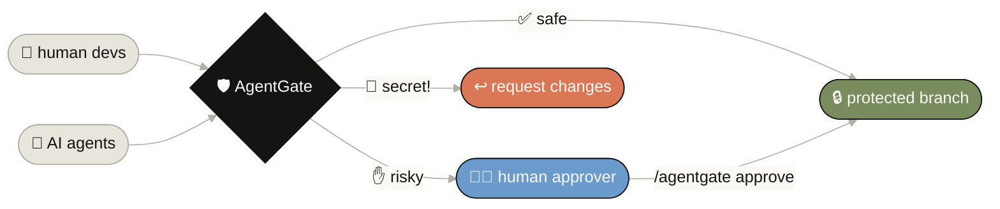
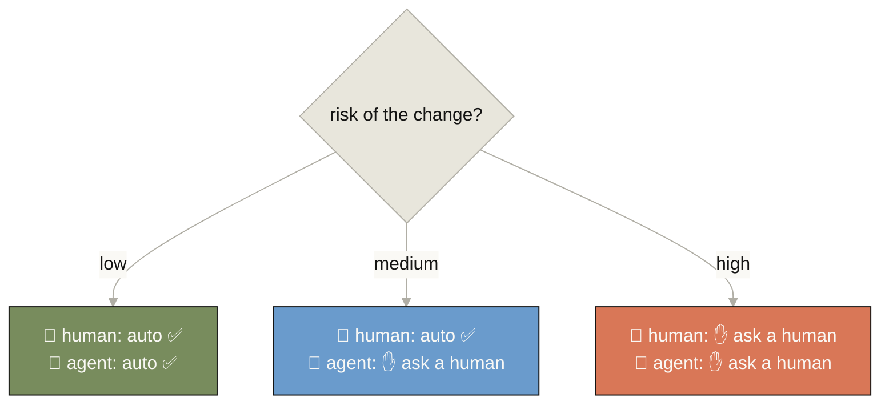
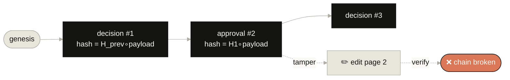

<div align="center">

# 🛡️ AgentGate

### The trust & accountability gate for human **+ AI-agent** code changes.

**When agents stop *talking* and start *doing* — merging code, moving money, mutating prod — the question isn't "did it say something wrong?" It's "is this actor allowed to take *this action*, and can we prove it later?" AgentGate is the gate that answers it — for humans and AI agents alike.**

First wedge: a **PR firewall for coding agents**, built for a world where 10–50 developers *and* AI coding agents open pull requests every day.

[](https://github.com/wjlgatech/agentgate/actions/workflows/ci.yml)
[](pyproject.toml)
[](tests/)
[](src/agentgate/policy/default_policy.yaml)
[](LICENSE)

[Quick Start](#-quick-start) · [Why](#-why-agentgate) · [How it works](#-how-it-works--a-10-year-old-can-follow-this) · [Architecture](#-architecture-io-edge--pure-core) · [The Ledger](#-the-audit-ledger-court-grade-not-a-log-file) · [Roadmap](ROADMAP.md) · [Docs](#-docs)

</div>

---

> ### Today's CI asks "do the tests pass?" Tomorrow's asks "should this actor have done this?"
> A pull request from a jailbroken agent can be green *and* catastrophic. The gate a team needs is not another linter — it's a **policy-as-data firewall** that knows *who* is acting, holds agents to a stricter bar than humans, and writes every decision to a **tamper-evident ledger** so "the agent did X" becomes court/compliance-grade evidence. AgentGate is that gate, built as **swappable seams** with a **pure, offline-testable core** — so every decision is deterministic and every claim is proven by a test, not a vibe.

---

## 📰 News

- **2026-07-09** — **Phase 1: the live GitHub loop lands (code-complete, offline-verified)**. The
  gate can now post its decision as a **check-run** (escalate / request-changes map to
  non-`success` conclusions, so branch protection keeps the PR unmergeable) plus a **review** and a
  **comment with reasons + an audit id**. `fetch_changeset` follows GitHub's Link-header pagination —
  dogfooding caught a real params-override **infinite-loop** bug (passing an empty params dict
  overwrites the cursor URL) before it could ship. The **human-approval loop** is live:
  `/agentgate approve` on an escalated PR verifies the commenter's **write access** against GitHub
  (authorization, not just identity) and records both grants *and* refusals to the ledger. Every
  network boundary is an `httpx`-injectable seam, so all of it is covered by **deterministic offline
  tests** (`httpx.MockTransport`, no key, no network). **42 tests, lint clean.** Live-repo E2E
  (real App token minting) is the one remaining gate → [phase-1 spec](docs/specs/phase-1-github-loop.md),
  [ADR-001](docs/adr/001-approval-channel.md).
- **2026-07-09** — **v0.1 — the core gate ships (Phase 0)**. The offline pipeline —
  **verify → classify actor → deterministic checks → decide → audit** — is complete and honest:
  webhook HMAC verification (unsigned → `401`), actor classification (human / ai_agent / bot),
  deterministic evidence checks (secrets · protected paths · diff size), an **actor-aware** decision
  engine (agents auto-merge *low*-risk only; anything riskier routes to a human), a **hash-chained
  audit ledger**, and idempotent job processing. Policy is **data, not prompt** — a jailbroken agent
  can't argue past a YAML file. Stubs raise `NotImplementedError`; they never fake a pass.

---

## 🧒 How it works — a 10-year-old can follow this

> The diagrams below use the Anthropic brand palette (ink `#141413`, paper `#faf9f5`, accents orange
> `#d97757` / blue `#6a9bcc` / green `#788c5d`) — the same look as
> [AnyAgent](https://github.com/wjlgatech/anyagent). The text is right here in the page, so you can
> copy it, change a word, and make your own.

**The big picture — one gate, two kinds of author, one protected branch:**



🧒 *Like a bouncer at a door. Some people walk right in (safe changes). Some get stopped and have to
ask a grown-up (risky changes). And if someone's hiding something dangerous (a secret), they're turned
away. **Robots get carded harder than people.***

**What happens inside the gate — the five steps:**

```mermaid
%%{init: {'theme':'base','themeVariables':{'primaryColor':'#e8e6dc','primaryTextColor':'#141413','primaryBorderColor':'#b0aea5','lineColor':'#b0aea5','secondaryColor':'#faf9f5','tertiaryColor':'#faf9f5','fontFamily':'Poppins, ui-sans-serif, system-ui, -apple-system, Arial, sans-serif'}}}%%
flowchart LR
    classDef anthroOrange fill:#d97757,color:#faf9f5,stroke:#141413;
    classDef anthroBlue fill:#6a9bcc,color:#faf9f5,stroke:#141413;
    classDef anthroGreen fill:#788c5d,color:#faf9f5,stroke:#141413;
    classDef anthroInk fill:#141413,color:#faf9f5,stroke:#141413;
    V[🔑 verify<br/>is this really from GitHub?] --> C[👤 classify<br/>human · agent · bot?]
    C --> K[🔎 check<br/>secrets · protected paths · size]
    K --> D[⚖️ decide<br/>actor-aware policy]
    D --> L[📜 audit<br/>write it in permanent ink]
    class V anthroBlue;
    class C anthroOrange;
    class K anthroOrange;
    class D anthroInk;
    class L anthroGreen;
```



🧒 *First: check the letter is really signed (not a fake). Then: who wrote it? Then: look inside for
anything scary. Then: decide using the rulebook. Last: write down what happened in a special notebook
where **nobody can erase a page without everyone noticing**.*

**The actor-aware rulebook — robots are held to a stricter bar:**



🧒 *A grown-up can grab a snack on their own. A robot can grab a snack too — but for anything bigger it
has to ask first. Nobody, robot or grown-up, gets to touch the stove alone.* It's all in one file:
[`default_policy.yaml`](src/agentgate/policy/default_policy.yaml).

---

## 🤔 Why AgentGate

Today's merge gate answers "do the tests pass?" That's the wrong question when the author might be an
autonomous agent. AgentGate answers a different one — **"should *this actor* have taken *this action*,
and can we prove it?"** — and keeps the answer honest by construction:

| | A normal CI check / bot | **AgentGate** |
|---|---|---|
| Knows *who* authored the PR | no — a diff is a diff | **classifies human · ai_agent · bot** |
| Holds agents to a stricter bar | no | **yes — actor-aware policy** (agents auto-merge low-risk only) |
| Where behavior is defined | buried in code / a prompt | **policy-as-data** (`default_policy.yaml`, versioned & reviewed) |
| On missing evidence | often silently passes | **escalates** — never auto-approves without evidence |
| Proof after the fact | a mutable log line | **hash-chained, tamper-evident ledger** |
| Unimplemented paths | fake a success | **raise `NotImplementedError`** — an honest ❌ over a fake ✅ |

The full origin story is in [`docs/00-BACKGROUND.md`](docs/00-BACKGROUND.md); the competitive
landscape and demand signals in [`docs/01-MARKET.md`](docs/01-MARKET.md); the plan (a SPEC per stage)
in [`ROADMAP.md`](ROADMAP.md).

---

## 🚀 Quick Start

```bash
make install            # pip install -e ".[dev]"   (Python 3.11+)
make check              # ruff + pytest — THE canonical gate (42 tests, no network)
make run                # uvicorn on :8099

# or the full stack (api + worker + postgres + redis):
cp .env.example .env    # set GITHUB_WEBHOOK_SECRET
make docker-up
```

Point a GitHub App's webhook at `POST /webhooks/github` (setup in
[`docs/03-ARCHITECTURE.md`](docs/03-ARCHITECTURE.md)). For live GitHub App auth, add the optional
extra: `pip install '.[github]'` (mints installation tokens by signing the App JWT).

**See it work, offline, in one command** — the pipeline decides + audits with a fake GitHub:

```bash
make check              # 42 deterministic tests: verify→classify→check→decide→audit, + the approval loop
```

---

## 🔬 A human PR and an agent PR, same diff — different outcome

The heart of *"for human + AI agents"*: the **same medium-risk change** (say, a ~1,200-line diff) is
**auto-approved for a human** but **escalated for an agent**, because the policy holds agents to a
stricter bar. (A *high*-risk change — e.g. a protected path — escalates for **both**; the divergence
is at the medium tier.)

```python
from agentgate.worker import evaluate
from agentgate.domain import ActorKind
# a ~1,200-line diff → medium risk (between max_churn 800 and hard_max_churn 3000)
evaluate(pr(ActorKind.HUMAN),    changes, policy).action   # → AUTO_APPROVE  (human auto-merges medium)
evaluate(pr(ActorKind.AI_AGENT), changes, policy).action   # → ESCALATE      (agent needs a human ≥ medium)
```

`evaluate(pr, changes, policy)` is the **pure, deterministic core** — no network, no key, no
database. That's why the whole decision surface is testable offline. Wire it to GitHub with
`process_job()` (idempotent, audited, posts back).

## 🔎 The checks — deterministic evidence collectors

Each check answers one question about the diff, offline, and reports a **severity** (its risk *if* it
fails) and whether it's **blocking** (a hard `request_changes`, not an escalation):

| Check | Fails when… | Severity | Blocking |
|---|---|---|---|
| `secret_scan` | a credential/API key appears in the diff | high | **yes** — hard block |
| `touched_paths` | a protected glob is touched (`.github/workflows/**`, `**/auth/**`, `policy/**`, migrations, Dockerfiles) | high (configurable) | no — escalate |
| `diff_size` | churn exceeds `max_churn` / `hard_max_churn` | medium / high | no — escalate |

Add one under `src/agentgate/checks/`, register it in `checks/registry.py`, add its config to the
policy schema, and write a deterministic test. (Design DNA: AnyAgent's `EvidenceCollector` seam —
*no evidence ⇒ escalate*, never a fake pass.)

## 🧑‍⚖️ The human-approval loop — authorization, not just identity

An escalated PR is unmergeable until a human with **write access** approves it by commenting:

```
/agentgate approve
```

AgentGate consumes the `issue_comment` webhook, then verifies the commenter's repo permission
against GitHub (`admin | maintain | write`) — a comment is only an *identity claim*, so the
**authorization** check is load-bearing and unit-tested directly. The grant flips the check-run to
`success` (unblocking merge) and is written to the ledger with the approver + timestamp; a **refusal**
(insufficient access) is audited too, never silent. Why comment-command over a web UI:
[ADR-001](docs/adr/001-approval-channel.md).

## 📜 The audit ledger — court-grade, not a log file

Every consequential event (a decision, an approval, a refusal) is appended as a **hash-chained**
record: `hash = sha256(prev_hash | kind | canonical(payload))`. Re-walking the chain detects any
insertion, deletion, or edit of history — turning "the agent did X" into evidence you can stand behind
(EU AI Act, FINRA auditability).



🧒 *A magic notebook where each new page is stamped with a fingerprint of the page before it. Tear one
out or scribble on it, and every fingerprint after it stops matching — so cheating is **obvious**.*

`GET /audit/verify` → `{"intact": true}`.

---

## 🧠 Architecture: I/O edge ∘ pure core

The pipeline splits a thin **I/O edge** from a **pure, deterministic core**, so the whole decision
surface runs in tests with no network, no key, and no real database — the same discipline that lets
AnyAgent test to its seams.

```
src/agentgate/
  webhooks/     # verify HMAC (first security gate) + parse PR / issue_comment events
  actor.py      # classify author: human · ai_agent · bot   ← the "for human + AI agents" heart
  checks/       # deterministic evidence collectors (secret · paths · size) — pure, offline
  policy/       # policy-as-data: schema + default_policy.yaml + loader (a jailbreak can't argue past YAML)
  decision.py   # combine checks (+ optional LLM review) → an actor-aware Decision  ← PURE
  review/       # optional LLM risk-review seam (raises until wired — no fake pass)
  audit.py      # hash-chained, tamper-evident ledger
  github_client.py  # GitHub REST seam: fetch changeset · post decision · approval (httpx-injectable)
  worker.py     # evaluate() [PURE] → audit → persist → post back;  handle_job() dispatch
  main.py       # FastAPI: webhook entrypoint + /healthz + /reviews/recent + /audit/verify
```

### The seams (every external boundary has a real body **and** a test fake)

| Seam | What it swaps | Bodies |
|---|---|---|
| `Queue` | how jobs move | **in-process deque** (dev) · **Redis** (scale-out) |
| `GitHubClient` | the GitHub REST calls | **real (httpx)** · **`MockTransport` / fake** in tests |
| `Check` | one evidence question | secret · touched-paths · diff-size (+ your own) |
| `Policy` | all gate behavior | **`default_policy.yaml`** (data, not code) |
| LLM `review` | optional risk read | seam present; **raises until wired** (honest, not faked) |

Because the GitHub boundary is injectable, tests exercise the **real** request-building code
(pagination, payload shapes, the decision→check-run mapping, the authorization check) with zero
network — which is exactly how dogfooding caught the pagination infinite-loop bug.

---

## ✅ Tested — the core is offline & deterministic

```bash
make check        # ruff check + pytest → 42 passing, ~0.1s, no network, no key, no real disk
```

- Unsigned webhook → `401`; signed PR event → `202 queued`; signed `/agentgate approve` → `202 queued`
  (approval); `GET /audit/verify` → `intact: true` — all live-verified through the app.
- `make check` is **the** canonical gate — CI runs exactly it, and an `anyagent goal --drive` run
  discovers it. An honest ❌ beats a fake ✅; stubs raise, they don't lie.

---

## 📚 Docs

| Doc | What's in it |
|---|---|
| [`ROADMAP.md`](ROADMAP.md) | Single source of truth — the 5 phases, each with a SPEC + a runnable Definition of Done |
| [`docs/00-BACKGROUND.md`](docs/00-BACKGROUND.md) | The origin story — build → market read → this product |
| [`docs/01-MARKET.md`](docs/01-MARKET.md) | Competitive landscape + demand signals |
| [`docs/03-ARCHITECTURE.md`](docs/03-ARCHITECTURE.md) | The pipeline, the GitHub App wiring, the data model |
| [`docs/04-SECURITY.md`](docs/04-SECURITY.md) | Threat model, trust boundaries, the audit ledger |
| [`docs/05-POLICY.md`](docs/05-POLICY.md) | Policy-as-data: the schema and how to tune the gate |
| [`docs/specs/`](docs/specs/) | One SPEC per phase — the contract; the code proves it |
| [`docs/adr/`](docs/adr/) | Architecture decisions ([ADR-001: approval channel](docs/adr/001-approval-channel.md)) |
| [`AGENTS.md`](AGENTS.md) | Contributor guide for humans **and** AI agents — the one rule: `make check` must pass |

---

## 📄 License

Private and proprietary — see [`LICENSE`](LICENSE). This repository is confidential; access does not
grant any license.
