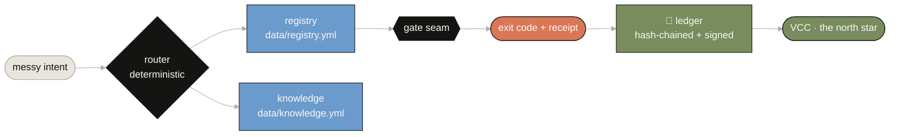

<div align="center">

# 🛡️ secure-anything

### The composition layer for agent security — **lean core, rich ecosystem.**

**Agent security is drowning in tools. This is the layer above them: one registry of what exists, one deterministic router from an intent to the right capability, one uniform seam that turns any of them into a comparable exit code, and one tamper-evident ledger of what was actually checked.**

[](https://github.com/wjlgatech/secure-anything-core/actions/workflows/ci.yml)
[](pyproject.toml)
[-d97757)](tests/test_core_invariants.py)
[](LICENSE)
[](LICENSE-DATA)

[Charter](docs/VISION.md) · [Roadmap](ROADMAP.md) · [The super-tool](skills/secure-anything/SKILL.md) · [Contributing](CONTRIBUTING.md)

</div>

---

## Where we stand

<!-- BEGIN GENERATED: northstar -->
<!-- END GENERATED: northstar -->

> **Zero VCC is the honest answer, and it is the point.** The north star only counts a capability
> whose gate has actually run *here* and left a receipt. Listing tools moves it by nothing. Most
> security landscape docs are scored on how many logos they contain; this one is scored on how
> many were actually executed. The number is a work queue, not a scoreboard.

---

## Why this exists

There are dozens of good agent-security tools and no agreement on what any of them prove. Every
vendor reports a different number, in a different format, against a different threat list. So the
honest question — *"which of the OWASP Agentic risks is my system actually covered against, and
what evidence backs that?"* — has no mechanical answer.

This repo is an attempt at one:

| | |
|---|---|
| 🧠 **Lean core** (`src/secure_anything/`, ≤600 LOC, CI-gated) | a **registry** of capabilities · a deterministic **router** · a uniform **gate seam** · a hash-chained, Ed25519-signed **ledger** · a computable **north star** |
| 🌍 **Rich ecosystem** (`data/*.yml`) | **capabilities** (scanners, guardrails, red-team, benchmarks, policy, provenance) + **knowledge cards** (papers, books, blogs, people, labs, standards), every fact API-verified and evidence-tiered |

The core is deliberately small and a test enforces it: `test_core_is_lean` fails the build if the
composition layer grows past its budget, and `test_core_names_no_vendor_or_protocol` fails if the
core ever learns what a GitHub is. Domain logic belongs in an **organ** or an upstream
**satellite** — never in the middle.

## The three ideas worth stealing even if you never use this

1. **The status ladder.** ⚪ candidate (named) → 🟡 digested (pinned SHA + a digest on disk) → 🟢
   integrated (its gate **ran here**, exit code recorded in `runs/`). `scripts/verify_registry.py`
   *refuses* a promotion whose evidence is missing. An awesome-list can claim 200 tools; this can
   only claim what left a receipt.
2. **Evidence tiers on every claim.** ✅ `verified` (read at the primary source) · 🟢
   `corroborated` (≥2 independent secondary sources) · 🟠 `claimed` (one interested party — never
   restate its numbers as fact) · 🔴 `disputed` (kept **on purpose**: a correction retained beats a
   claim repeated). Half of our own north-star denominator sits at `corroborated`, and we say so.
3. **No evidence means no.** A capability that could not run is `NOT_MEASURED`, reported by name
   and excluded — never silently converted into a pass. A blocking gate can never be green while
   something is unmeasured.



---

## Quick start

```bash
make install     # pip install -e ".[dev]"   (Python 3.11+)
make check       # ruff · charter · registry evidence · drift · self-audit · pytest
make northstar   # Verified Control Coverage, computed offline from data/
make route Q="scan my repo for vulnerabilities"
```

Try the router — it is the whole product in three commands:

```console
$ make route Q="scan my repo for vulnerabilities"
capabilities: ['codex-security']

$ make route Q="llamafirewall"
capabilities: ['purplellama']
WARN purplellama: license NOASSERTION is unconfirmed — POINTER ONLY. Run it upstream;
     do not vendor it and do not execute it in our CI.

$ make route Q="book me a flight to tokyo"
capabilities: -
No capability or knowledge card covers: 'book me a flight to tokyo'
```

That last one matters most: **the router banks the gap instead of guessing.** A router that always
finds something is not routing, it is flattering you.

---

## Capabilities

<!-- BEGIN GENERATED: capabilities -->
<!-- END GENERATED: capabilities -->

## Knowledge base

Every card carries the tier of evidence that actually backs it, and a date.

<!-- BEGIN GENERATED: knowledge -->
<!-- END GENERATED: knowledge -->

---

## Honest edges

- **VCC is 0%.** Nothing has been integrated with a run receipt yet. The ecosystem is indexed, not
  proven, and the README will not pretend otherwise.
- **Half the north-star denominator is `corroborated`, not `verified`.** The OWASP Agentic Top 10
  titles come from four agreeing secondary sources because the primary is a PDF download. See the
  note in `data/controls.yml`.
- **Control mappings are ours.** Which capability covers which OWASP item is a judgement call we
  authored (`mappings_asserted_by: secure-anything`), not the upstream project's claim. **Please
  dispute them** — [`.github/ISSUE_TEMPLATE/gate-dispute.md`](.github/ISSUE_TEMPLATE/gate-dispute.md)
  exists for exactly that, and a downgrade to `disputed` is a welcome outcome.
- **The ledger is tamper-evident, not tamper-proof.** Hash-chaining plus Ed25519 defeats everyone
  except an operator holding both the key and the database. External anchoring (Rekor / WORM /
  RFC3161) is unbuilt, so this repo does not use the word "tamper-proof".
- **Freshness is measured, not promised.** Several satellites have had no upstream push in months;
  the registry records `upstream_pushed_at` so STALE is a fact rather than a vibe.
- **A green gate is evidence, not an audit opinion** — not a certification, not a permit, and not
  legal advice about any regulation.
- **The reference organ is not open.** The composition core is fully here; the PR-firewall organ
  built on it is developed privately and appears in the registry as a pointer, contributing zero to
  the north star. See [CONTRIBUTING.md](CONTRIBUTING.md#what-is-and-is-not-here).

## Contributing

The highest-value contribution is **evidence**: a pinned digest for a ⚪ candidate, a primary
source that upgrades a card's tier, a control mapping you think is wrong, or a capability we are
missing. See [CONTRIBUTING.md](CONTRIBUTING.md).

## License

**Code** (`src/`, `scripts/`, `tests/`) — [Apache-2.0](LICENSE).
**Data** (`data/`, `docs/satellites/`, `eval/`) — [CC BY 4.0](LICENSE-DATA), so the curation can be
reused and cited wherever it is useful. Satellites keep their own licences; an unresolved licence
is treated as restrictive and marked pointer-only.
